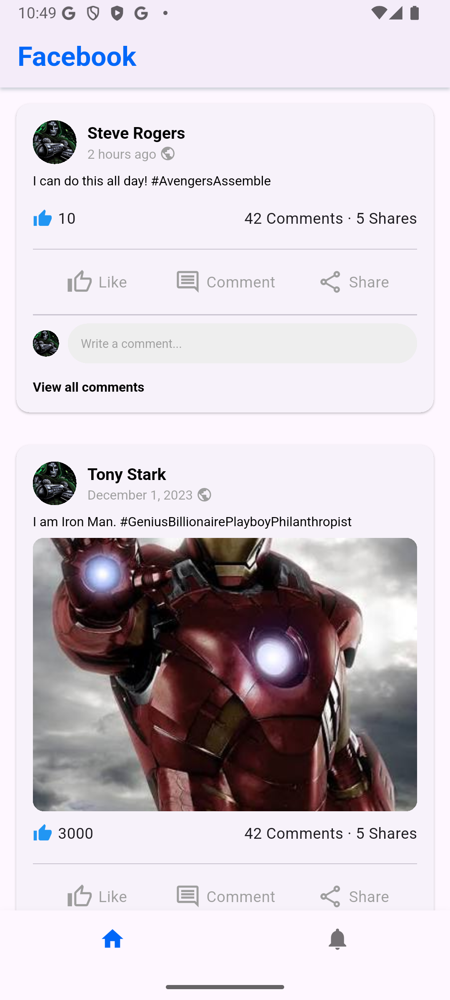
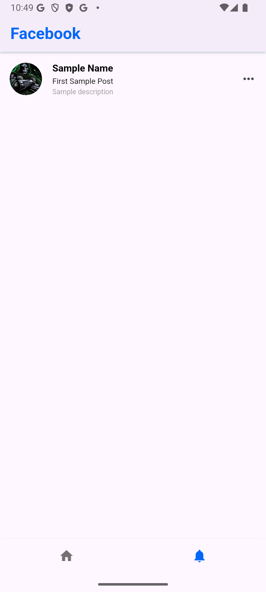
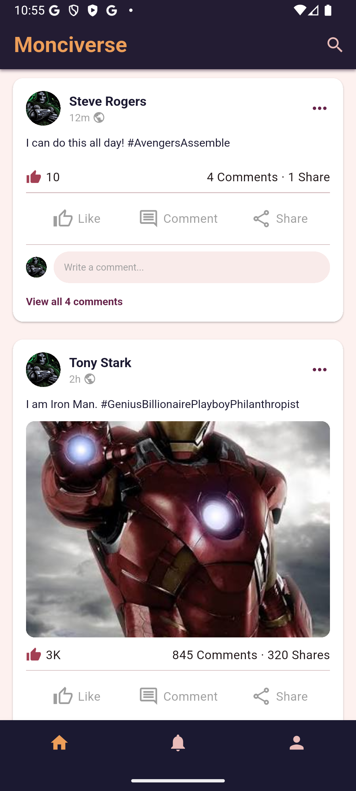
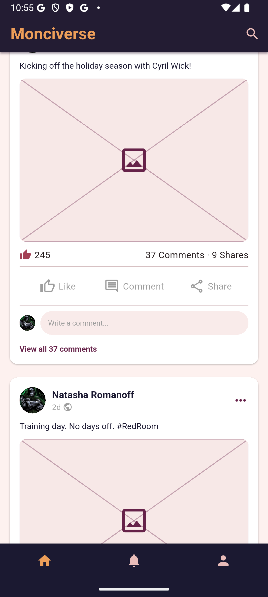
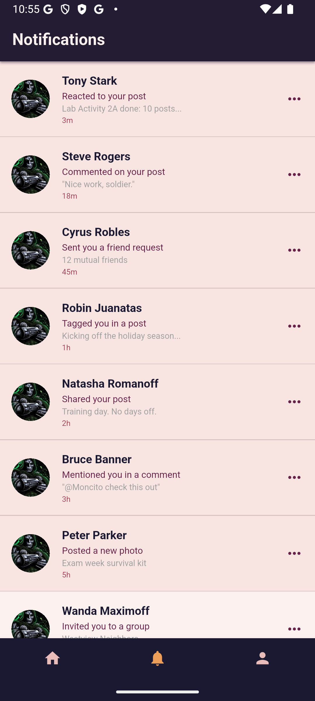
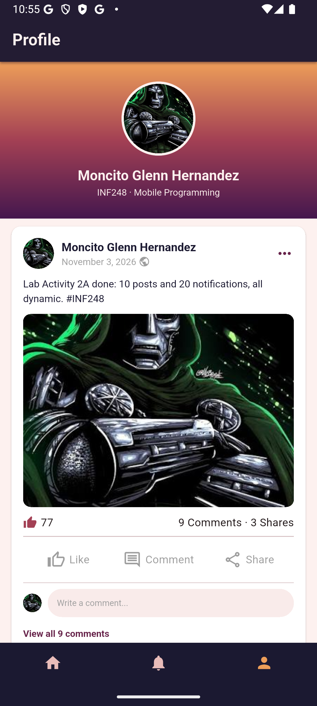
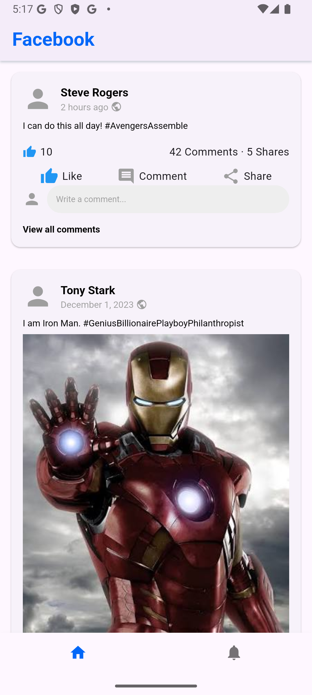
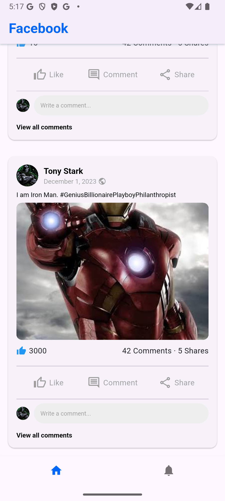

# hernandez_mobprog

Monciverse: a Facebook-style social media app built with Flutter and `flutter_screenutil` for Mobile Programming (Lab Activities 1A and 2A).

**Student:** Moncito Glenn Hernandez · **Section:** INF248

## Project structure

```
lib/
├── data/
│   └── dummy_data.dart           (10 posts, 20 notifications)
├── models/
│   ├── notification_item.dart
│   └── post.dart
├── screens/
│   ├── home_screen.dart
│   ├── newsfeed_screen.dart
│   ├── notification_screen.dart  (Lab 2A)
│   └── profile_screen.dart       (Lab 2A, 3rd tab)
├── widgets/
│   ├── custom_text.dart
│   ├── newsfeed_card.dart
│   ├── notification_card.dart    (Lab 2A)
│   ├── post_action_button.dart
│   └── post_image.dart
├── constants.dart                (color palette, app name, formatters)
└── main.dart
```

---

# Lab Activity 2A: List Widgets

## Enhancements

- **General:** 10 posts and 20 notifications, kept in `lib/data/dummy_data.dart` and shown with `ListView.builder` / `ListView.separated`.
- **Enhancement 1: Dynamic posts.** Each post is a `Post` object with its own likes, comments and shares (big numbers shortened, like `3K`), its own date (shown as `12m`, `2h`, `1d` or `November 3, 2026`), and one of three image states: a real image (`imagePath`), an empty placeholder (`hasPlaceholder: true`), or no image at all.
- **Enhancement 2: Dynamic AppBar title.** The title follows the selected tab: `Monciverse`, `Notifications` or `Profile`.
- **Enhancement 3: More BottomNavigationBar items.** Added a third item, Profile, with its own `ProfileScreen`.
- **Enhancement 4: App name.** The app is now called **Monciverse** (`appName` in `constants.dart`, the `MaterialApp` title and the Android launcher label).
- **Enhancement 5: Color palette.** `constants.dart` now uses the palette `#1B1931`, `#44174E`, `#662249`, `#A34054`, `#ED9E59`, `#E9BCB9` and imports `package:material_ui/material_ui.dart`.

## Lab Activity 2: Discussion

**How did I manage the posts and the notifications efficiently?**

Instead of writing ten `NewsFeedCard(...)` and twenty `NotificationCard(...)` widgets by hand inside the screens, I separated the data from the UI. I made two small model classes, `Post` and `NotificationItem` (in `lib/models/`), and put all the sample data in one file, `lib/data/dummy_data.dart`, as two lists. The screens only loop over those lists:

```dart
ListView.builder(
  itemCount: posts.length,
  itemBuilder: (context, index) => NewsFeedCard(post: posts[index]),
);
```

`ListView.builder` only builds the cards that are visible on the screen, so scrolling stays smooth even with many posts. Adding a new post or notification is now just adding one entry to the list; the screen and card code do not change. The notification screen works the same way with `ListView.separated`, which also adds a divider between items, and unread notifications get a light highlight.

**How did I accomplish the enhancements?**

1. **Dynamic posts:** `NewsFeedCard` now receives a whole `Post` instead of separate fields. The counts come from `numOfLikes`, `numOfComments` and `numOfShares`, formatted by `formatCount()` (and singular/plural labels like "1 Share"). Every post has a real `DateTime`, and `formatDate()` turns it into Facebook-style text, so the dates stay correct relative to today. For the image, the card checks `imagePath` first, then `hasPlaceholder`:
   ```dart
   if (post.imagePath != null)
     PostImage(imagePath: post.imagePath!)
   else if (post.hasPlaceholder)
     const PostImagePlaceholder(),
   ```
   `PostImagePlaceholder` draws the empty crossed box with a `CustomPainter`.
2. **Dynamic AppBar title:** `HomeScreen` keeps a list of titles and shows `_titles[_selectedIndex]`. `_selectedIndex` changes both when a tab is tapped and when the user swipes the `PageView`, so the title always matches the page.
3. **More navigation items:** I added a Profile `BottomNavigationBarItem` and a `ProfileScreen` as the third page of the `PageView`.
4. **App name:** one `appName` constant is used everywhere, so the name is changed in one place.
5. **Color palette:** all colors live in `constants.dart`, so the widgets use names like `fbPrimary` and `fbDarkPrimary` instead of hard-coded hex values.

**Challenges and how I addressed them**

- *The AppBar title did not change when swiping between pages.* Updating `_selectedIndex` only on tap was not enough, so I also update it in `onPageChanged`.
- *Hard-coded dates looked fake and never changed.* I replaced the date strings with `DateTime` values and a `formatDate()` helper.
- *Three different image states in one card.* A single `hasImage` flag could not express "placeholder", so the `Post` model has both `imagePath` and `hasPlaceholder`, and the card checks them in order.
- *`package:flutter/material.dart` is deprecated in the newer Flutter version.* I switched the imports to `package:material_ui/material_ui.dart`, as in the given `constants.dart` snippet.
- *Widget test looked for "Notifications" twice* (the AppBar title and the hidden bottom-nav label). I scoped the test to the `AppBar`.

## Output (Lab 2A)

| Before: newsfeed | Before: notifications |
| --- | --- |
|  |  |

| After: newsfeed | After: placeholder posts | After: notifications | After: profile |
| --- | --- | --- | --- |
|  |  |  |  |

---

# Lab Activity 1A: File Structuring | Design Pattern


## Enhancements

1. **Image widget for post images.** `PostImage` (`lib/widgets/post_image.dart`) wraps `Image.asset` with rounded corners, full width, a fixed height and `BoxFit.cover`.
2. **Avatar image for the user profile.** The generic person icon was replaced with a `CircleAvatar` that uses an `AssetImage`, both in the post header and the comment box.
3. **Widget-based Like, Comment and Share buttons.** `PostActionButton` (`lib/widgets/post_action_button.dart`) takes an icon, a label and an `onPressed` callback, so all three buttons share one widget.

## Lab Activity 1: Discussion

*(Written for Lab 1A. In Lab 2A the same idea moved into the `Post` model.)*

**How did I integrate the image into `newsfeed_card.dart` and make it dynamic, whether it has an image or not?**

I did not put the `Image.asset` code directly inside the card. Instead, I created a separate reusable widget called `PostImage` in `lib/widgets/post_image.dart`. It receives an `imagePath` and displays the image using `Image.asset`, wrapped in a `ClipRRect` for rounded corners, with `width: double.infinity`, a fixed height and `BoxFit.cover` so every post image has the same size and look.

To make it dynamic, `NewsFeedCard` has an optional (nullable) parameter `String? imagePath`. Each post in `newsfeed_screen.dart` decides for itself whether it has an image:

```dart
NewsFeedCard(
  userName: 'Steve Rogers',
  postContent: 'I can do this all day! #AvengersAssemble',
  date: '2 hours ago',
  numOfLikes: 10,
), // no imagePath, so no image

NewsFeedCard(
  userName: 'Tony Stark',
  postContent: 'I am Iron Man. #GeniusBillionairePlayboyPhilanthropist',
  date: 'December 1, 2023',
  numOfLikes: 3000,
  imagePath: 'assets/images/iron_man.jpg',
), // has an image
```

Inside the card, a getter checks if a path was given, and a collection `if` adds the image to the `Column` only when it exists:

```dart
bool get hasImage => imagePath != null;
...
if (hasImage) PostImage(imagePath: imagePath!),
```

So a text-only post (Steve Rogers) shows no empty space for an image, while a post with an image (Tony Stark) shows it. Any new post can show any picture just by passing a different `imagePath`, without changing the card's code. The same idea is used for the profile picture through the `avatarPath` parameter.

## Output (Lab 1A)

| Before enhancement | After enhancement | After (post with image) |
| --- | --- | --- |
|  |  |  |

## Run

```bash
flutter pub get
flutter run
```
